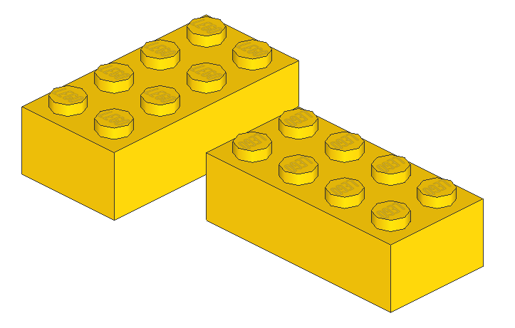
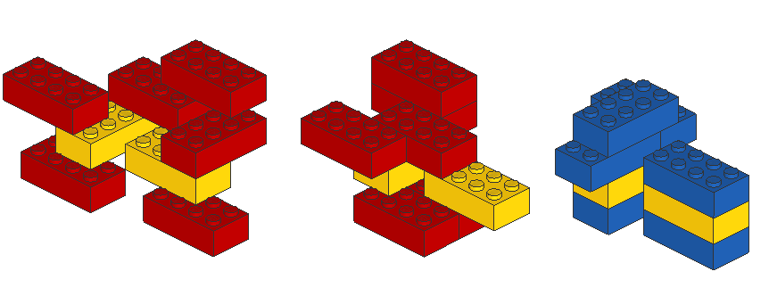
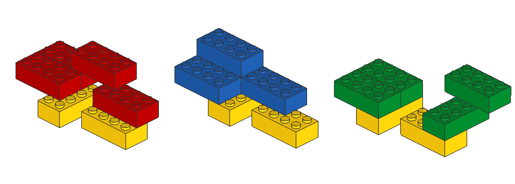
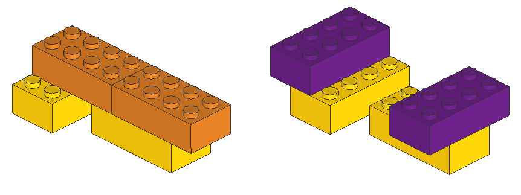

# Counting models of 2 x 4 LEGO bricks

## Results

### OEIS A112389

[OEIS A112389](https://oeis.org/A112389) is the number of ways, counted up to symmetry, to build a contiguous model with N LEGO bricks of size 2 X 4. The following table contains the known values of this sequence, which we denote a(N).

| N  | a(N)                | Author(s)              |
|:--:|--------------------:|:-----------------------|
|  1 |                   1 |                        |
|  2 |                  24 | Kristiansen 1974       |
|  3 |                1560 | Anonymous 2002         |
|  4 |              119580 | Eilers 2004            |
|  5 |            10166403 | Eilers 2004            |
|  6 |           915103765 | Eilers 2004            |
|  7 |         85747377755 | Abrahamsen-Eilers 2006 |
|  8 |       8274075616387 | Abrahamsen-Eilers 2006 |
|  9 |     816630819554486 | Nilsson 2014           |
| 10 |   82052796578652749 | Simon 2018             |
| 11 | 8364925094730088313 | Eilers 2026            |


### OEIS A123829

[OEIS A123829](https://oeis.org/A123829) is the number of ways, counted up to symmetry, to build a contiguous model with N LEGO bricks of size 2 X 4 which is **symmetric** after a rotation by 180 degrees. The following table contains the known values of this sequence, which we denote a<sup>180</sup>(N).

| N  | a<sup>180</sup>(N)| Author(s)        |
|:--:|------------:|:-----------------------|
|  1 |           1 |                        |
|  2 |           2 | Kristiansen 1974       |
|  3 |          44 | Anonymous 2002         |
|  4 |         185 | Eilers 2004            |
|  5 |        3276 | Eilers 2004            |
|  6 |       15682 | Eilers 2004            |
|  7 |      282377 | Abrahamsen-Eilers 2006 |
|  8 |     1480410 | Abrahamsen-Eilers 2006 |
|  9 |    26264942 | Nilsson 2014           |
| 10 |   145036229 | Deleuran 2025          |
| 11 | 2556043967  | Eilers 2026            |


# Project Overview

It took "a matter of months" to compute a(9) and more than 1.5 years to compute a(10).
Since there currently is no known way of computing the sequence without iterating through (most of) the models, the time to compute a(N+1) is roughly 100 times the time to compute a(N).
As 150 years of computing resources is a high price to pay for a(11), we seek to find novel ways of computing subsets of a(11) more efficiently and reduce the amount of models that have to be counted individually.

## Definitions

- A "brick" refers to a 2 x 4 LEGO brick with 8 studs on top. For this project we only concern ourselves with bricks that are connected to each other using the studs, and only at rectillinear ("right") angles. The position of a brick is thus identified by its coordinate pair (x,y), its orientation (horizontal or vertical) and the height of which it is placed: A "base brick" is located at (0,0) at height 0. A brick connected to a base brick from above has the height 1, and so on.

- A "model" consists of one or more bricks connected by their studs. Recall that all connections are rectilinear. [Another project](https://github.com/LasseD/BrickCounting) concerns bricks connected at all possible angles. We consider two models to be the same if they are rotationally symmetric. The code base uses "combination" and "model" interchangeably.

- A(N) is the set of all models with exactly N bricks.

- a(N) is the size of A(N).

- A<sup>180</sup>(N) is the subset of A(N) where the models are symmetric after 180 degrees of rotation. a<sup>180</sup>(N) is the size of A<sup>180</sup>(N). Similarly A<sup>90</sup>(N) is the subset of A(N) where the models are symmetric after 90 degrees of rotation, and a<sup>90</sup>(N) is the size of A<sup>90</sup>(N).

- A "layer" of a model is the subset of bricks of the model whose height is the layer. The "base layer" or "first layer" refers to the lower-most layer of a model (at height 0). The "extreme" layers are the base and top-most layers.

- The "height" of a model is the number of layers of it.

- A "refinement" A(N,M,Z<sub>1</sub>,Z<sub>2</sub>,...,Z<sub>M</sub>) is the subset of A(N) where the models have height M and the sized of the layers from base layer and up are Z<sub>1</sub>, Z<sub>2</sub>, ... Z<sub>M</sub>. a(N,M,Z<sub>1</sub>,Z<sub>2</sub>,...,Z<sub>M</sub>) is the size of refinement A(N,M,Z<sub>1</sub>,Z<sub>2</sub>,...,Z<sub>M</sub>). We use the shorthand <Z<sub>1</sub>,Z<sub>2</sub>,...,Z<sub>M</sub>> to denote a(N,M,Z<sub>1</sub>,Z<sub>2</sub>,...,Z<sub>M</sub>).


# Software Implementations

This project contains two approaches to compute a(N): "Brute-Force Approach" and "Wave Approach". The sections below provide brief overviews of these.


## Brute-Force Approach

The folder [/brute_force_approach](brute_force_approach/) contains the source code for a "brute force" algorithm.

The brute force algorithm constructs A(N) by iterating through A(N-1) and adding a single brick at every possible location of every model.

Each constructed model is checked for being the first of its kind being computed. Only the first models of their kind are counted, and optionally written to disk.

This is a very simplistic and inefficient approach that iterates through all models, but has the advantage of being able to write all models to disk for visualization and providing a baseline of comparison for more efficient algorithms.


## Wave Approach

Abrahamsen and Eilers presented the following approach to compute a(N) in 'Eilers 2016':
Consider the first brick at the first layer of any model as being fixed.
Construct all models by adding bricks to this first brick.
Divide the final counts to address symmetries.

Our "wave" algorithm constructs models iteratively by following this approach.

Consider a model M (initially the single brick on the first layer), as well as a "wave" being the set initially consisting of the single brick.

Let S be the set of bricks that can be connected to the bricks of the wave while not connecting to any previous bricks of M.

New models are constructed by picking a subset T from S, placing the bricks of T on M and applying the algorithm iteratively with the "wave" being T.

This is repeated for all possible subsets T while ensuring that the bricks of T do not overlap with themselves.

The folder [/wave_approach](wave_approach/) contains the source code.


# Lemmas

Key insights of how to efficiently compute a(N) are captured in the lemmas of this section. Lemma 1 has been known since a(4) was computed, while Lemma 2 and Lemma 3 have been developed by us to improve the performance when computing a(11).


## Lemma 1 “Divide and Conquer”

Let a “bottleneck” be a non-extreme layer of size 1.

If a refinement has a bottleneck, then we can easily compute its size from the size of smaller refinements:

Let B = A(N,M,Z<sub>1</sub>,...,Z<sub>n</sub>,...Z<sub>M</sub>), Zn=1, 1<n<M be a refinement with the bottleneck Z<sub>n</sub>.

Consider the refinements obtained by splitting B at the bottleneck:

C = A(N_C,n,Z<sub>1</sub>,...,Z<sub>n</sub>) and D = A(N_D,m-n+1,Z<sub>n</sub>,...,Z<sub>M</sub>)

All models in B can be constructed by combining all models from C with those from D.
We have to pay attention for symmetries.
Consider a non-symmetric model c from C. The models in B that can be constructed from c is 2 |D| minus the symmetric models in D, as they would otherwise be double-counted. The multiplier "2" comes from the fact that all non-symmetric models can be rotated 180 degrees at the bottleneck.

If c is symmetric, then all models of D can be used once to construct models in B.
By using the 180-superfix to denote rotationally symmetric models and "-" to denote models that are not, this can be written as following:


|B<sup>-</sup>| = 2 |C<sup>-</sup>| |D<sup>-</sup>| + |C<sup>-</sup>| |D<sup>180</sup>| + |D<sup>-</sup>| |C<sup>180</sup>|


|B<sup>180</sup>| = |C<sup>180</sup>| |D<sup>180</sup>|


|B| = |B<sup>-</sup>| + |B<sup>180</sup>|


L1 thus provides us with an efficient method of computing the size of all refinements that have at least one bottleneck, should the size of smaller refinements be at hand.


### Applying Lemma 1 to compute A112389

The method from L1 is used in the python script "sum-for-size.py" where results for refinements without bottlenecks are being typed in, thus allowing you to compute the numbers a(N) and a<sup>180</sup>(N). As an example, compute the numbers for six bricks by running:

```
python3 sum-for-size.py 6
```

The results will be printed on a line with "TOTAL" followed by a(N), followed by a<sup>180</sup>(N) in parenthesis.


## Lemma 2 "Two Brick Belt"

Lemma 1 can be extended from bottlenecks with 1 brick to non-extreme layers two bricks. We call such a layer a "belt" of two bricks. Consider a belt consisting of these two yellow bricks (Colors are used to help the viewer. All bricks should be considered to be red for computations):



Let's consider the models of refinement <2231> where the belt is the second layer (layer 1). Some example models are the two models with red bricks in this picture. The model with blue bricks is not a model due to it not being connected. We call this a "construction" to keep the definition of models clean:



Since the belt splits the model in a "bottom" part and a "top" part, we can compute the total number of "full" models by multiplying the number "tops" with the number of "bottoms" and subtracting the number of invalid (not connected) models.

Let C be the subset of <231> where the base consists of the bricks of the belt. Let C<sup>^</sup> be constructions built by building on top of the yellow bricks with the same layer sizes as <231>, but without connecting the two bricks. In the picture below the models with red and blue bricks are in C, while the construction with green bricks is in C<sup>^</sup>.



Let D and D<sup>^</sup> similarly be constructed from placing two bricks in a layer on top of the yellow bricks. In the picture below the model with orange bricks is in D, while the construction with purple bricks is in D<sup>^</sup>.



The number of models with the yellow bricks on the second layer is:

(|C| + |C<sup>^</sup>|) (|D| + |D<sup>^</sup>|) - |C<sup>^</sup>| |D<sup>^</sup>|

The example shows the yellow bricks forming a non-symmetric layer. For symmetric layers the computations follow the logic displayed in Lemma 1 to ensure proper computation of symmetric and non-symmetric models.


## Lemma 3 "Generalization of Lemma 2"

Lemma 2 can be generalized to belts of larger sizes. Here the same considerations are made: symmetric models can be built on symmetric belts and connectivity should be ensured for all counted models. This is achieved by grouping models by their connectivity. See the code base for implementation details.

### Applying Lemma 3 in Practice

We have used Lemma 3 to create files of "precomputations" where all bases are iterated and all models are counted on top of them while keeping track of connectivity and symmetry. See the folders prefixed by "base" under the "wave_approach" folder.

Our software can use the precomputation files to compute refinements. As an example can <2242> be considered as having the belt on second layer, so the number of models can be computed by the precomputations of base two with a layer of 2 bricks on top(base_2_size_4_refinement_22) and the precomputations with three layers, the extreme ones with two bricks and the middle with 4 (base_2_size_8_refinement_242).

The feasability of this approach comes from two aspects:

- Keeping the belts small. For belts of size 2 to 4 this is achievable on normal hardware, while experiments show that a non-standard amount of storage (more than 1TB) and significant computation time is needed for belts of size 5 and up.

- Keeping the belts centered. Since all possible bases are iterated, the time spent for each base has to be minimal. This approach only works when there is a balance between the sizes of the "tops" and "bottoms".


### Running Time

TODO: Section under construction.

Consider the precomputations for base B up to maximal distance D where models of size n are built for each base.

(8D)^B  *  B * O(A(n)) = (8D)^B  *  B * 100^n


## Lemma 4 "Two Brick Base Work Reduction"

TODO: This section is still under construction and used for an optimization in computing precomputations

Let A(<...>, E) be the refinements with encoding E.

A(<2Z2Z3...>, E_1):
 Z2 = 1:
  Brick must be bridging both (single-brick bridge/SBB): Sum <1Z3...> (from refinements A) with bridging placements
 Z2 = 2:
  Cache <2Z3...> with base placements and based on encoding: Q2
  For all SBB: Sum from <2Z3...> from A
  For no SBB: Use and update Q2
  TODO
 Z2 = 3:
  Cache <3Z3...> with base placements and based on encoding: Q3
  TODO

A(<2Z2Z3...>, E_0):
 Z2 = 1:
  For all non-SBB placements: Sum <1Z3...> (from refinements A)
 Z2 = 2:
  For all bases where both bricks touch only one brick: Sum from Q2
  For all bases where one brick touches each: Sum non-connecting from Q2
  If one brick touches one base brick:
   Let X = <2Z3...> be result. Initially overcounts where another brick touches one of the originals
   For all second-brick placements touching either base brick: Reduce count in Q2 from X
 Z2 = 3:
  For all bases where all bricks touch only one brick: Sum from Q3
  For all bases where one brick touches one base brick and two touch the other: Sum non-connecting from Q3
  For all initial-brick placements:
   X = <3Z3...> includes overcounts
   Reduce overcounts from Q3
...
 Z2 = 5:
  Q2...Q5 = caches for bases to be reused (might not be needed in the end)
  Case: 5 bricks touch initial two bricks:
   - Compute all and store in Q5 (use Q5 for mirrors and translations)
  Case: 4 bricks touch initial two bricks:
   - For each base B:
    - Build all X combinations from second layer while ignoring base layer
    - Remove counts from Q5 which overlap with B
    - Use Q4 to not double-count mirrors and translations
  Case: 3 bricks touch initial two bricks:
   - For each base B:
    - Build all X combinations from second layer while ignoring base layer
    - Remove counts from Q4 and Q5 which overlap with B
    - Use Q3 to not double-count mirrors and translations
  ...
  Case: 1 brick touch initial two bricks:
   - For each brick B:
    - X = <1Z3...>
    - Remove counts from Q2, Q3, Q4 and Q5 which contain B
 ->
  for i = 1 ... 5:
   for all placements B of i bricks on base:
    X = all models buildable on B, ignoring first layer
    ret += X
    ret -= X * d, where d is number of ways X are overcounted for smaller i
